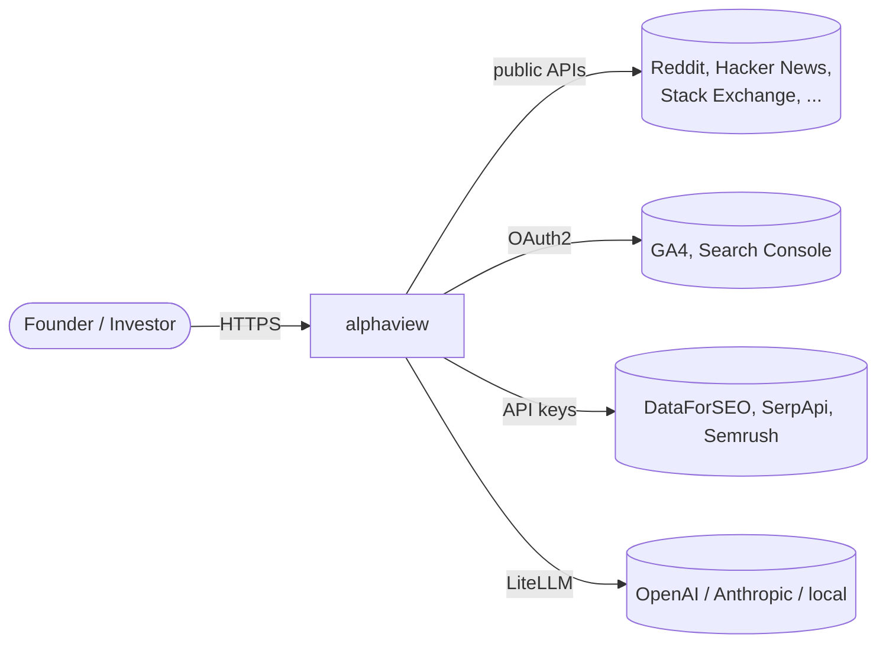
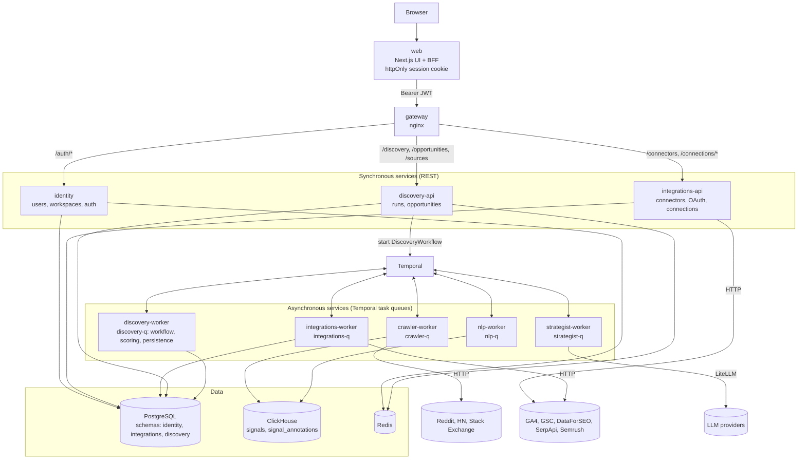
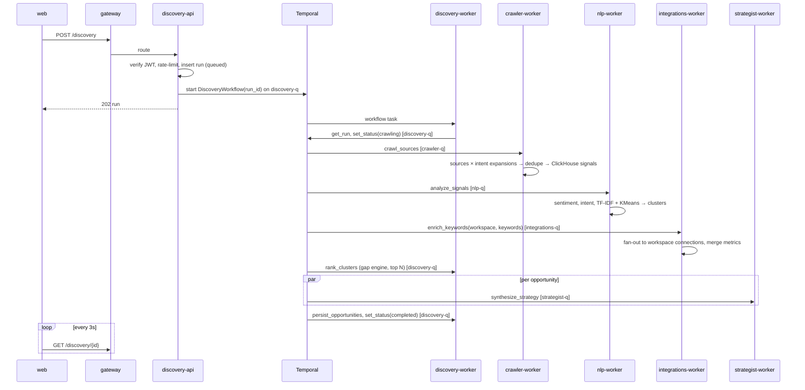
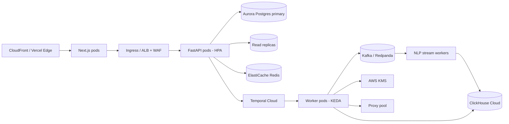

# alphaview — High-Level Design (HLD)

## 1. Context

## 2. Microservice architecture (current implementation)

| Service | Type | Owns (data) | Communicates via | Scaling |
|---|---|---|---|---|
| web | Next.js | session cookie | REST → gateway | Horizontal / edge |
| gateway | nginx | — | path routing | Horizontal behind LB |
| identity | FastAPI | `identity` schema | REST; issues JWT with `ws` claim | HPA on CPU/RPS |
| integrations-api | FastAPI | `integrations` schema | REST | HPA |
| integrations-worker | Temporal worker | `integrations` schema (read) | `integrations-q` | KEDA on queue backlog |
| discovery-api | FastAPI | `discovery` schema | REST; starts workflows | HPA |
| discovery-worker | Temporal worker | `discovery` schema | `discovery-q` (workflow + local activities) | KEDA |
| crawler-worker | Temporal worker | ClickHouse `signals` (writer) | `crawler-q` | KEDA; I/O bound |
| nlp-worker | Temporal worker | ClickHouse `signal_annotations` | `nlp-q` | KEDA; CPU bound |
| strategist-worker | Temporal worker | — (stateless) | `strategist-q` | KEDA; LLM rate-limit bound |
| Temporal | infra | workflow state | gRPC | Temporal Cloud / HA |
| PostgreSQL | infra | 3 service schemas, no cross-schema FKs | — | Replicas → split DB per service |
| ClickHouse | infra | shared append-only event store | — | Sharded cluster |
| Redis | infra | rate-limit counters | — | Managed cluster |

**Service boundaries**
- Auth is stateless: identity signs a JWT with `sub` (user) and `ws` (workspace); every other service verifies it locally with the shared secret, so there are no synchronous calls to identity at request time.
- Data ownership: each service writes only its own Postgres schema. References across services (`workspace_id`, `created_by`) are plain UUIDs.
- Contracts live in `packages/py-common/alphaview_common/contracts.py`: task-queue names, activity names, and source ids. Activities exchange JSON-serializable dicts.
- The ClickHouse `signals` table is a shared event store: crawler is the only writer, nlp reads it.

## 3. Discovery pipeline

## 4. Integration (connector) architecture

- **Plugin contract**: every tool implements `test()` and `enrich(keywords)` and returns **normalized metric names** (`search_volume`, `cpc`, `competition`, `trend_growth`, `serp_results`, `owned_*`). The gap engine only depends on these names, so new tools are added without touching scoring.
- **Auth types**: `api_key` (validated live before saving) and `oauth2` (Google; signed `state`, offline refresh token).
- **Storage**: credentials encrypted (Fernet → KMS in prod), non-secret config in JSON.
- **Usage**: automatic enrichment inside every run + ad-hoc keyword queries from the Integrations page.
- **Isolation**: connector failures are captured per connection and never fail a run.

## 5. Scaling to millions of users

| Concern | Design decision |
|---|---|
| Stateless compute | API and workers hold no session state; JWT auth; scale pods horizontally |
| Long jobs off the request path | API only enqueues; Temporal workers do heavy work; UI polls lightweight status |
| Burst load | KEDA scales workers on Temporal queue depth; bounded crawler concurrency per worker |
| Hot reads | Opportunities read from Postgres replicas; add Redis read-through cache + CDN for static assets |
| Write-heavy signals | ClickHouse columnar inserts in batches; partitioned by month, TTL 180 days |
| Multi-tenancy | `workspace_id` on every tenant row and every query; per-workspace quotas in Redis; Postgres RLS planned |
| Shared corpus (cost) | Next phase: continuous global crawl into Kafka → ClickHouse so popular topics are crawled once and reused across tenants; runs then query the corpus instead of re-crawling |
| LLM cost/latency | Only top-N clusters synthesized; parallel calls; LiteLLM routing (small vs. large model) and semantic cache planned |
| External API limits | Per-connector concurrency; future token-bucket per provider in Redis |
| Resilience | Temporal retries (3× per stage), idempotent activities, run status reflects failures |
| Observability | OpenTelemetry traces across Next → API → Temporal → activities; Temporal UI for workflow inspection |

## 6. Target production topology

Multi-AZ for every stateful component; infrastructure managed via Terraform, deployments via ArgoCD (GitOps).

## 7. Security architecture

- Browser ↔ Next.js: httpOnly session cookie; Next.js injects `Authorization: Bearer` on proxied calls.
- API: JWT verification, workspace scoping, Pydantic validation at every boundary, CORS allow-list.
- Secrets: connector credentials encrypted, env-injected platform secrets (K8s secrets / Secrets Manager).
- Untrusted content: crawled text is treated as data in prompts; LLM output schema-validated and rendered as text.
- Abuse: Redis rate limiting; WAF at the ingress in production.

## 8. Key design decisions

| Decision | Alternatives | Rationale |
|---|---|---|
| Temporal for pipeline | Celery, Prefect | Durable state, per-stage retries, observability, long-running safe |
| ClickHouse for signals | Postgres only, BigQuery | Cheap high-volume ingestion, fast aggregations, TTL |
| Python backend | Node/NestJS, Go | NLP/ML/LLM ecosystem; FastAPI async performance adequate, Go reserved for future hot paths |
| BFF proxy in Next.js | Direct browser → API | Token never in JS; single origin; no CORS for app traffic |
| Normalized connector metrics | Per-tool scoring | Scoring decoupled from vendors; easy to add tools |
| TF-IDF + KMeans baseline | Embeddings + HDBSCAN | Zero external cost, deterministic; embeddings are a drop-in upgrade |
