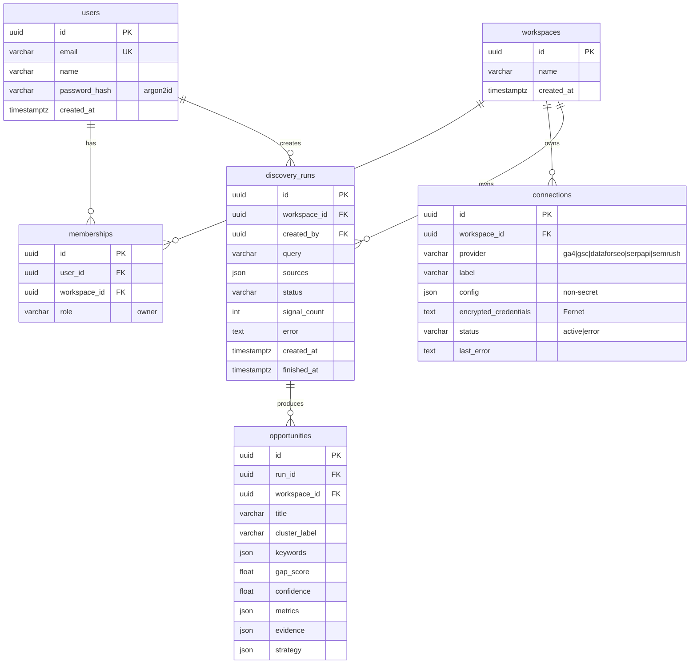
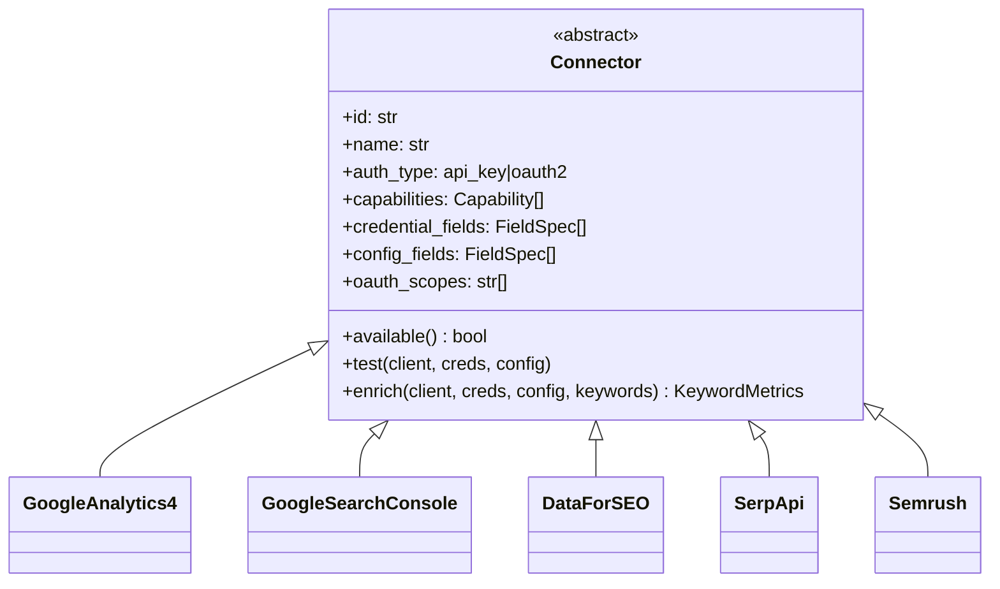
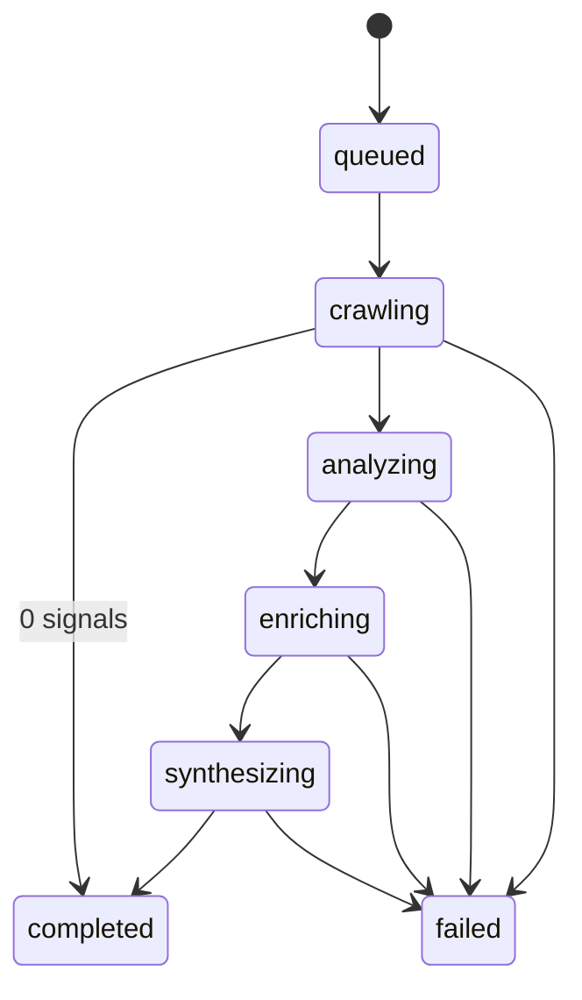
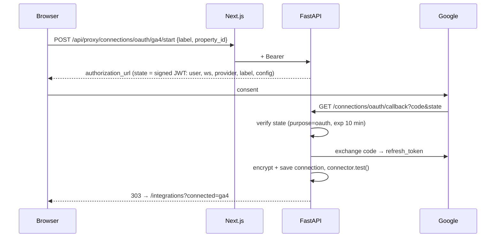

# alphaview — Low-Level Design (LLD)

## 0. Service map

| Service | Package | Entrypoints | Postgres schema | Temporal queue | Gateway routes |
|---|---|---|---|---|---|
| common lib | `packages/py-common/alphaview_common` | — | — | — | — |
| identity | `services/identity/alphaview_identity` | `main:app` | `identity` | — | `/auth/*` |
| integrations | `services/integrations/alphaview_integrations` | `main:app`, `worker` | `integrations` | `integrations-q` | `/connectors`, `/connections*` |
| discovery | `services/discovery/alphaview_discovery` | `main:app`, `worker` | `discovery` | `discovery-q` | `/discovery*`, `/opportunities*`, `/sources` |
| crawler | `services/crawler/alphaview_crawler` | `worker` | — (ClickHouse `signals`) | `crawler-q` | — |
| nlp | `services/nlp/alphaview_nlp` | `worker` | — (ClickHouse `signal_annotations`) | `nlp-q` | — |
| strategist | `services/strategist/alphaview_strategist` | `worker` | — | `strategist-q` | — |
| gateway | `services/gateway/nginx.conf` | nginx | — | — | all of the above |

## 1. Data model

### 1.1 PostgreSQL (one schema per service)

Relationships across schemas are logical only (plain UUID columns, no FKs). FKs exist only inside a schema: `identity.memberships → identity.users/workspaces`, `discovery.opportunities → discovery.discovery_runs`. Schemas are created on service startup under a Postgres advisory lock so concurrent replicas do not race.

Indexes: `users.email` (unique), `memberships(user_id)`, `connections(workspace_id)`, `discovery_runs(workspace_id, created_at)`, `opportunities(run_id)`, `opportunities(workspace_id)`, `opportunities(gap_score)`.

### 1.2 ClickHouse (shared event store)

`signals` — written only by **crawler**, read by **nlp**:

| Column | Type | Notes |
|---|---|---|
| run_id | UUID | sort key part 1 |
| id | String | sha1(source:external_id), sort key part 2 |
| source | LowCardinality(String) | reddit / hackernews / stackexchange |
| external_id, url, title, text | String | text truncated to 4 000 chars |
| created_at | DateTime('UTC') | post time |
| engagement, comments | Int32 | |
| answered | Nullable(UInt8) | Stack Exchange only |
| ingested_at | DateTime('UTC') | partition key (month), TTL 180 days |

`signal_annotations` — written by **nlp**: `run_id, id, sentiment Float32, intent LowCardinality(String), annotated_at` (same engine, keys and TTL).

Engine `ReplacingMergeTree`, `ORDER BY (run_id, id)`; reads use `FINAL` so activity retries are idempotent.

## 2. API specification

All endpoints are reached through the gateway (`:8000`). All except `/auth/register`, `/auth/login`, `/connectors`, `/sources`, `/health` and the OAuth callback require `Authorization: Bearer <jwt>`. Each service also exposes its own `/health` and (non-production) `/docs`.

| Method | Path | Request | Response | Notes |
|---|---|---|---|---|
| POST | `/auth/register` | `{email, name, password≥10}` | `201 {access_token}` | creates user + workspace + membership; 409 on duplicate; RL 10/h/IP |
| POST | `/auth/login` | `{email, password}` | `{access_token}` | 401 generic; RL 10/15 min per IP+email |
| GET | `/auth/me` | — | `UserOut` | |
| GET | `/connectors` | — | `ConnectorOut[]` | catalog incl. field specs, availability |
| GET | `/connections` | — | `ConnectionOut[]` | never returns credentials |
| POST | `/connections` | `{provider, label, credentials, config}` | `201 ConnectionOut` | api_key only; live `test()` before save |
| POST | `/connections/oauth/{provider}/start` | `{label, config}` | `{authorization_url}` | state = signed JWT (10 min) |
| GET | `/connections/oauth/callback` | `code, state` | `303 → /integrations?connected=` | exchanges code, stores refresh token |
| POST | `/connections/{id}/test` | — | `ConnectionOut` | updates status/last_error |
| POST | `/connections/{id}/query` | `{keywords[1..20]}` | `{kw: {metric: value}}` | ad-hoc lookup |
| DELETE | `/connections/{id}` | — | `204` | |
| GET | `/sources` | — | `[{id, name}]` | crawler adapters |
| POST | `/discovery` | `{query, sources[]}` | `202 RunOut` | RL per workspace; starts workflow `discovery-{run_id}` |
| GET | `/discovery` | — | `RunOut[]` (50) | |
| GET | `/discovery/{id}` | — | `RunDetailOut` | includes opportunities sorted by score |
| GET | `/opportunities?min_score=` | — | `OpportunityOut[]` (50) | workspace-wide ranking |
| GET | `/opportunities/{id}` | — | `OpportunityOut` | |
| GET | `/health` | — | `{status}` | |

Errors use FastAPI's `{detail: string | ValidationError[]}` shape.

## 3. Module design (services)

### 3.1 Auth (`alphaview_common.security`, `alphaview_common.auth`, `alphaview_identity.main`)
- `hash_password` / `verify_password`: argon2-cffi defaults (Argon2id).
- `create_token(sub, purpose, ttl, **claims)`: HS256 JWT with `purpose` claim (`access` | `oauth`); `decode_token` enforces purpose.
- identity issues access tokens with claims `sub` (user id) and `ws` (workspace id from the user's first membership).
- `get_principal` (common, used by every service): Bearer → verify JWT → `Principal(user_id, workspace_id)`. No DB lookup; tokens without `ws` are rejected.

### 3.2 Connectors (`alphaview_integrations.connectors`)

| Connector | Endpoint(s) | Output metrics |
|---|---|---|
| GA4 | `analyticsdata v1beta properties/{id}:runReport` (dimension `searchTerm`, metric `eventCount`, 90 d, CONTAINS filter) | `owned_site_searches` |
| GSC | `webmasters/v3/sites/{site}/searchAnalytics/query` (dimension `query`, contains filter, 90 d) | `owned_impressions`, `owned_clicks` |
| DataForSEO | `keywords_data/google_ads/search_volume/live` | `search_volume`, `cpc`, `competition` (index/100), `trend_growth` (from monthly_searches) |
| SerpApi | `engine=google_trends` (12 m TIMESERIES) + `engine=google` | `trend_growth`, `serp_results` |
| Semrush | `type=phrase_this` (`Ph,Nq,Cp,Co`) | `search_volume`, `cpc`, `competition` |

`growth_ratio(series)` = (mean of last quarter − mean of first quarter) / mean of first quarter.

**Merge policy** (`alphaview_integrations.enrichment`): connections queried in parallel; per keyword/metric → `trend_growth`, `competition` averaged across providers, all others take the max. Each connection's `last_error` is updated. Exposed to the pipeline as activity `integrations.enrich_keywords(workspace_id, keywords)`.

**Adding a connector**: subclass `Connector`, return normalized metrics, register in `connectors/registry.py`. UI picks it up automatically from `/connectors`.

### 3.3 Crawler (`alphaview_crawler`)
- `Signal` dataclass (common), id = sha1(`source:external_id`).
- `SourceAdapter.search(client, query, since) -> list[Signal]`.
- `crawl(query, sources)`: for every adapter × `INTENT_EXPANSIONS` (`""`, `is there a tool`, `alternative to`, `frustrated with`, `I wish`) → `Semaphore(4)` bounded gather → dedupe by id → drop empty content. HTTP errors per call are logged and skipped.
- Activity `crawler.crawl_sources(run_id, query, sources)` inserts into `signals` and returns the count. Adapter ids must equal `contracts.SOURCES` (tested).

| Adapter | API | Fields used |
|---|---|---|
| Reddit | `reddit.com/search.json?t=year&limit=100` | title, selftext, score, num_comments, created_utc |
| Hacker News | `hn.algolia.com/api/v1/search` (`story,comment`, `created_at_i>` since) | title/story_text/comment_text, points |
| Stack Exchange | `/2.3/search/advanced` on stackoverflow, softwarerecs, webapps, superuser | title, body, score, view_count, answer_count, is_answered |

### 3.4 NLP (`alphaview_nlp`)
Activity `nlp.analyze_signals(run_id, query)`: fetch `signals` → annotate → write `signal_annotations` → cluster. CPU-bound steps run in a thread (`asyncio.to_thread`); worker concurrency capped at 8.
1. `annotate`: VADER compound sentiment; regex intent classification (ordered: wish → alternative → complaint → solution).
2. `cluster_signals(signals, query)`:
   - < 12 signals → single cluster.
   - `TfidfVectorizer(stop_words=english, ngram=(1,2), min_df=2, max_df=0.6, sublinear_tf)`.
   - `k = clamp(n // 25, 2, 8)`; `KMeans(n_init=10, random_state=42)`.
   - Label = top centroid terms excluding query words; clusters with < 3 members dropped.
   - Per cluster: size, engagement, velocity, neg_sentiment, demand/complaint/supply/unanswered ratios, sources, top-6 evidence, top-12 excerpts (≤300 chars, for the LLM).

### 3.5 Gap engine (`alphaview_discovery.gap`)
`score_gap(cluster, kw_metrics, connectors_used)` → `{gap_score, confidence, metrics{..., components, external, connectors_used}}`. Formula in FUNCTIONAL §5. External metrics aggregated over the cluster keywords: volume/cpc/serp → max; competition/trend → mean; owned_* → sum. Invoked by activity `discovery.rank_clusters`, which keeps the top `MAX_OPPORTUNITIES`.

### 3.6 Strategist (`alphaview_strategist.agent`)
- Activity `strategist.synthesize_strategy(query, cluster, scored) -> dict`.
- `synthesize(query, cluster, scored) -> Strategy` (Pydantic).
- If `litellm.validate_environment(model)` finds no key → `_fallback` heuristic (`generated_by="heuristic"`).
- Otherwise `litellm.acompletion` with system prompt (tone + JSON schema + untrusted-evidence rule), `response_format=json_object`, `temperature=0.3`, `timeout=90`. Validation or API failure → fallback.

### 3.7 Workflow (`alphaview_discovery.workflow`)

`DiscoveryWorkflow` runs on `discovery-q` and calls activities **by name** on other services' queues (names and queues in `alphaview_common.contracts`), so no service imports another service's code.

| Activity (name) | Queue / service | Input | Output | Timeout / retry |
|---|---|---|---|---|
| `discovery.get_run` | discovery-q | run_id | `{query, sources, workspace_id}` | 30 s |
| `discovery.set_status` | discovery-q | run_id, status, error, signal_count | — | 30 s |
| `crawler.crawl_sources` | crawler-q | run_id, query, sources | signal count | 15 min, 3 attempts |
| `nlp.analyze_signals` | nlp-q | run_id, query | `cluster[]` | 15 min, 3 attempts |
| `integrations.enrich_keywords` | integrations-q | workspace_id, keywords | `{kw_metrics, connectors_used}` | 15 min, 3 attempts |
| `discovery.rank_clusters` | discovery-q | clusters, enrichment | `[{cluster, scored}]` (top N) | 15 min, 3 attempts |
| `strategist.synthesize_strategy` | strategist-q (parallel per item) | query, cluster, scored | strategy dict | 15 min, 3 attempts |
| `discovery.persist_opportunities` | discovery-q | run_id, ranked, strategies | count | 15 min, 3 attempts; deletes prior opportunities of the run first (idempotent) |

Workflow id `discovery-{run_id}` prevents duplicate executions. On `ActivityError` the workflow records `failed` with the cause and re-raises.

## 4. Frontend design

| Route | Type | Data |
|---|---|---|
| `/login`, `/register` | client | POST `/api/auth/{login,register}` → sets `av_token` cookie |
| `/dashboard` | client | `sources`, `discovery` (polls 4 s while active), `opportunities` |
| `/runs/[id]` | client | `discovery/{id}` polled 3 s until terminal |
| `/opportunities/[id]` | client | `opportunities/{id}`; Recharts components chart |
| `/integrations` | client | `connectors`, `connections`; connect / OAuth / test / query / delete |
| `/api/proxy/[...path]` | route handler | adds `Authorization` from cookie; clears cookie on 401 |
| `middleware.ts` | edge | redirects unauthenticated users to `/login?next=` |

`lib/api.ts` → `api<T>()` and `post<T>()` wrap fetch to the proxy, map errors to `ApiError`, redirect on 401. `components/ui.tsx#Rich` renders `**bold**` safely as React nodes.

## 5. Sequence: OAuth connection

## 6. Error handling

| Layer | Strategy |
|---|---|
| Validation | Pydantic → 422 with messages surfaced in UI |
| Auth | 401 → proxy clears cookie → client redirects to login |
| Rate limit | 429 with message |
| Connector failures | API: 400 (create/test) / 502 (query); pipeline: stored on connection, run continues |
| Crawler failures | per-request log + skip |
| Workflow failures | Temporal retries, then run `failed` with cause |
| Temporal unavailable | run marked failed, 503; workers retry connecting at startup (30 × 2 s) |
| Service down | gateway returns 502 for that route only; other services keep working; Compose restarts the container |

## 7. Deployment & start-up

- `start.sh` / `start.bat` → `docker compose -f infra/docker-compose.yml --env-file .env -p alphaview up -d --build`; first run generates `.env` secrets; waits for `GET :8000/health`.
- One Python image definition (`infra/docker/python.Dockerfile`, `ARG SERVICE`) → `uv sync --frozen --package alphaview-<service>`; API and worker of the same service share an image.
- Start order enforced by health checks: Postgres/Redis/ClickHouse healthy → APIs healthy → gateway → web. Workers wait on infra and their service API (schema creation).
- Network trust: gateway at `172.28.0.5`, web at `172.28.0.10`; nginx accepts `X-Forwarded-For` only from web, services accept it only from the gateway.

## 8. Testing

| Suite | Location | Covers |
|---|---|---|
| common | `packages/py-common/tests` | password hashing, JWT purpose isolation, `ws` claim enforcement, credential encryption |
| integrations | `services/integrations/tests` | growth ratio, connector registry contract |
| crawler | `services/crawler/tests` | adapter ids match `contracts.SOURCES` |
| nlp | `services/nlp/tests` | intent classification, cluster output contract consumed by discovery/strategist |
| discovery | `services/discovery/tests` | gap score bounds/monotonicity; **workflow routing across all 5 task queues** with mocked activities in Temporal's time-skipping environment |
| strategist | `services/strategist/tests` | heuristic fallback without LLM key |
| web | `apps/web` | `tsc --noEmit` + `next build` |

Run everything: `make test` (`uv run pytest` from the repo root). Next: API integration tests with testcontainers.
